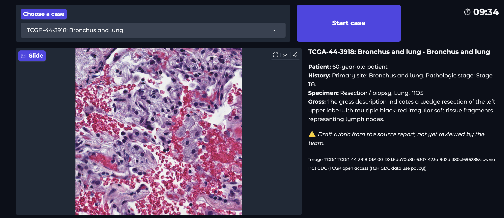
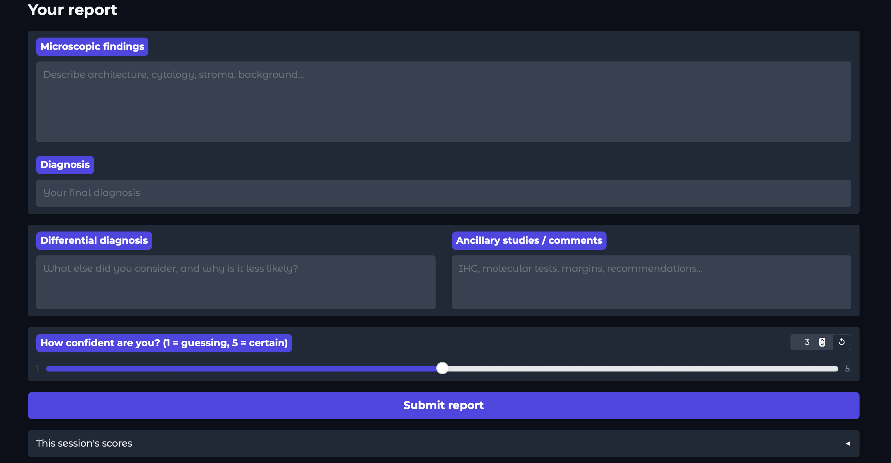
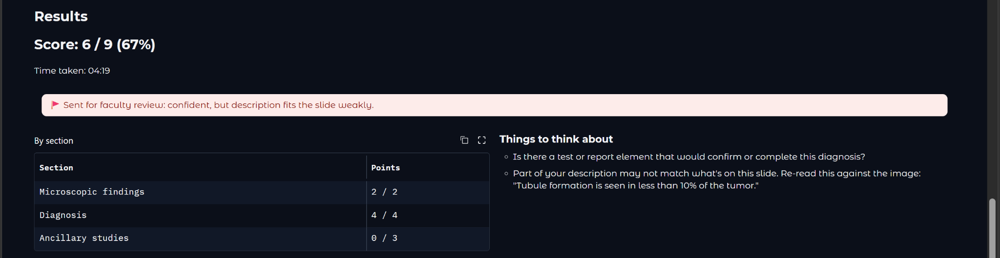
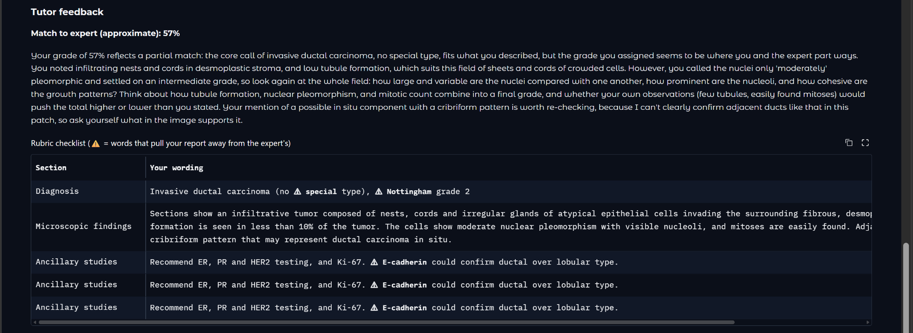
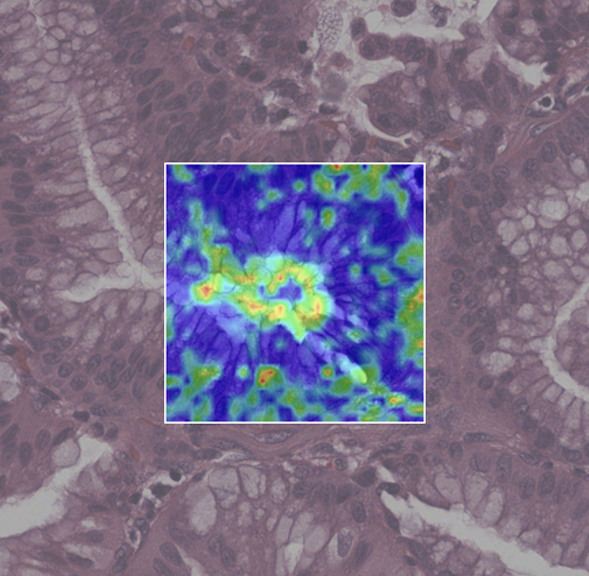

# [ashby-hackathon-fa26](https://cancer.illinois.edu/2026-ashby-prize-in-computational-science-hackathon/): PathTutor

Web app to practice writing pathology reports. Automated feedback enables regular practice, without waiting for attending availability. 

1. Open a timed case (a real TCGA slide tile plus clinical context)

2. Write a structured report. 

3. Get instant, precise, domain-informed feedback. Supports learning with multiple attempts, socratic hints.


4. Option to reveal full answer: see the expert-written report and a heatmap highlighting relevant visual features.


## How feedback works

**Rubric** Items from `cases.json` marked present / partial / missing, by keyword matching now (`USE_STUB = True`). |
- ⚠ marks potential errors, according to each word's share of cos(student section, expert report), computed from integrated gradients through [CONCH](https://github.com/mahmoodlab/CONCH)'s text encoder (`Utils.gradcam_text`). Words with a raw score ≤ `MISTAKE_THRESHOLD` (`app.py`) are marked. 
- Review flag: Reports with a grade < 50% and self-reported confidence ≥ 4 (`confidence.score_findings`) are flagged for faculty review (go to `data/review_queue.jsonl`).
**Guiding Suggestions** CONCH match % plus an LLM-generated Socratic explanation
- Avoids revealing the answer, uses a leak guard to reject explanations with words only in expert report
- Includes Socratic hints per section with gaps (`grader.socratic_feedback`)
**Understand the solution** with a [Grad-CAM](https://github.com/jacobgil/pytorch-grad-cam) heatmap
- Warmer colors = larger relative contribution to the slide–report match, relative to report describing healthy tissue
- Grad-CAM scores: ReLU(Σ activation × average gradient) per token, from one backward pass from the match score to the last ViT block's output. Scaled 0–1 within each case.
- Precomputed + stored in `cases.json` 

## Setup

**Python 3.11 is required.**
From the repo root:
```bash
pip3 install -r pathology-tutor-app/requirements.txt
```

**Model Access**
- **Hugging Face:** request access --> [`MahmoodLab/conch`](https://huggingface.co/MahmoodLab/conch), then `hf auth login` or set `HF_TOKEN`
- **Anthropic:** `export ANTHROPIC_API_KEY=...` to see LLM tutor feedback

## Model weights (one-time)

Save CONCH encoder weights:
```bash
cd pathology-tutor-app
python -c "from utils import Utils; Utils.save_conch_weights()"     # weights/conch.pt (765 MB)
```
`Utils.load_conch()` uses `weights/conch.pt` when it exists

## Running

```bash
cd pathology-tutor-app      # run from here so data/ resolves
python app.py               # http://127.0.0.1:7860
python app.py --share       # public gradio.live link (expires after 72 hours)
```

To use this environment in Jupyter, register it as a kernel and pick "Python (avenv)", with the notebook inside `pathology-tutor-app/`:
```bash
python -m ipykernel install --user --name avenv --display-name "Python (avenv)"
```

 ## `pathology-tutor-app/`

- `app.py` Gradio UI: case picker, timer, report form, results, reveal
- `grader.py` Rubric scoring, CONCH checks, review queue
- `llm_grader.py` Rubric checklist and LLM tutor feedback
- `confidence.py` match %, word scores, slide check
- `utils.py` model loading and saving, CONCH tokenizer, Grad-CAM and integrated gradients, heatmap generation and rendering
- `weights_utils.py` Save and load CONCH weights (fp16 / int8)
- `make_placeholders.py` Placeholder slide images for mock cases
- `tools/import_tcga.py` TCGA case importer

## Data

`pathology-tutor-app/data/cases.json` stores each case's 
- clinical context
- rubric items (`section`, `weight`, `keywords`, `partial_keywords`)
- expert answer
- ancillary results
- references
- precomputed heatmap

Images are in `data/images/`, report text in `data/reports/`. The 11 current cases (breast, lung, colon, prostate) were imported from TCGA with drafted rubrics. See the [app README](pathology-tutor-app/README.md) for the importer and review step.

## Future work
- **Use the whole tile** CONCH sees the center 448 × 448 of each 1024 × 1024 tile (about 19%), rest of image is not currently used by feedback or heatmaps
- **Update heatmaps** (1) Grad-CAM at the last ViT block mixes information across tokens (2) doesn't explain the diagnosis for cases where CONCH matches the tile to normal tissue better than to the expert text (i.e. poorly differentiated carcinoma -> diagnosis based on info outside slide image, such as other tests)
- **Explore other encoders for grading** CONCH is designed for image-text comparison, rather than text-text
- **Robust leak checks** The tutor-feedback check catches exact expert-diagnosis words, not paraphrases
